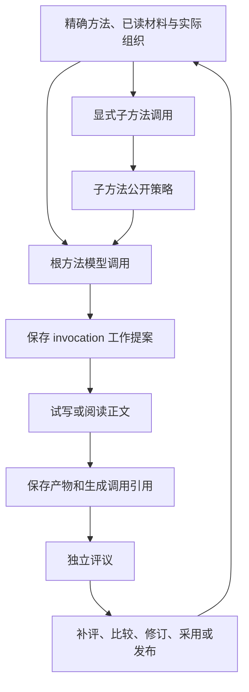

# v0.6.4：让方法结果进入生成，让评议留下开放的下一步

2026-10-11，`experiment/growth-reading`。本文说明新版 `growth-work-v3` 的运行方式及观察边界；既有冻结工作继续使用原协议。

## 本次修复的问题

样本中五个窗口在评议技术校验处暂停：三次试写后的附随评议、两次显式方法评议。三份试写已经安全保存，随后 `TECHNICAL_PROSE` 错误仍阻断了动作完成。评议是在讨论方法和工具，原实现仍套用小说正文的技术引用禁令，因此合法工作描述也可能被拒绝；失败原文没有保存，不能断定具体被拦截的词。另一方面，健康读轨的后续动作会覆盖整体状态，使页面看起来已经恢复。新版区分工作产物与叙事正文，并根据各作用域的实际状态汇总运行情况。

评议使用独立格式合同，可讨论已交付的操作与精确句柄。其文本保存为公开工作意见；正文继续拒绝技术 ID、来源编号、调试轨迹和私有信息。写在评议里的句柄本身不会授予权限，后续结构化动作仍检查作用域、类型和精确版本。

## 方法执行的两层

过去 `program.calls` 运行的是确定性组织程序：子方法产生选材和关系结构。这证明组织规则被执行，不能证明模型依据子方法重新考虑了写法。

新协议在新试写和阅读呈现前增加真正的 `invoke` 阶段，要求模型将保存的完整方法作用于当前实际材料，返回可执行的生成或阅读策略。显式 `calls` 的子方法先完成自己的策略调用，公开结果再作为上层调用的输入。根方法产物最终进入 `draft` 或 `render` 请求。

没有声明子调用的方法仍进行根调用。子调用阶次来自实际方法程序，引用祖先版本并不自动执行祖先。相同精确上下文的已完成结果可以缓存复用；失败恢复复用已保存阶段。循环仍需检查，挂起组织不会伪装成完成调用。

调用返回的是 `status: proposal_not_world_fact` 的工作提案。它可以提出新动作、关系、人物、知识、义务和时间尺度；这些设想通过随后试写及明确发布进入世界。读轨的呈现事件仍依据实际访问范围，方法调用改变其组织与解释；扩展世界需要另行试写发布。

## 再评议怎样改变下一次构造

评议获得实际作品、完整方法、已执行组织及所评对象。阅读评议也保留真实访问范围和路径依据，避免只根据一个节点目录判断连续阅读。已有工作意见和候选方案都保留其建议身份。

提示要求检验方法的判断尺度：是否反复把所有问题收缩到同类物件或微动作，是否存在新的行动选择、关系后果、知识变化、时间安排或跨窗口承接。模型可选择适用尺度，也可提出其他尺度。再评议要交付一种可尝试的差异以及观察效果的依据。

公开反馈可成为后续方法输入、组合依据或改版材料。采用与实际生成分别保存，程序没有因为评议阶次增加就自动宣布方法进步。新协议保证方法策略获得进入正文生成的实际通路；它仍不能保证模型采纳每条建议，也不能保证所产生的新内容有价值。

## 已保存产物与待补评议分开恢复

已安全落盘的草稿不会因之后评议的格式失败而丢失。失败形成 `review_debt`，会话显示“评议待补”，保留目标、阶段、请求与安全错误。债务尚未完成时有两种明确选择：

| 动作 | 实际含义 |
| --- | --- |
| `retry_review` | 对目录中指定的待补项实际补做评议；正常占用预算 |
| `publish` 携带 `allow_pending_review: true` | 明确发布对应草稿，保留未完成评议的记录 |

发布不会把评议债务标成完成。草稿格式、来源、权限和安全性校验依旧有效；这一机制只隔离安全产物之后的评议失败。

对已确认属于旧合同误判的历史技术暂停，恢复可以复用已经保存的阶段，留下真实欠评议状态，无需重写小说或追加模型请求。其他失败不能因为存在这一恢复路径而被当成已修复。

恢复工具 `scripts/recover_growth_reviews.py` 默认在临时数据库副本中检查。实际安装使用 `--apply --backup 新文件路径`，先创建权限为 `0600` 的一致备份，再验证对象和内核回放；已有备份文件不会被覆盖，安装前也会检查存档是否发生并发变化。使用时先暂停实验，参数为 `--database 数据库路径 --run-id 实验ID`。本次当前实验已恢复五个窗口：三份安全草稿和两次显式评议均保留待补记录，正文、原请求与资源账本保持不变，恢复使用零次模型调用。

## 页面和证据如何核查

窗口卡片与读轨区分“草稿已保存”“评议待补”和“可发布”。窗口技术错误独立展示，读轨成功不消除窗口暂停。方法和诊断页面提供工作提案、调用输入、子结果、生成产物精确引用及评议债务；连续阅读正文保持纯叙事。

| 证据 | 可以核查什么 | 不能直接证明什么 |
| --- | --- | --- |
| 方法程序中的 `calls` | 声明了哪些方法组合 | 模型已实际调用、结果已进入正文 |
| 组织执行帧与 `max_call_depth` | 结构执行、复用、挂起和深度 | 高阶判断质量 |
| 已保存的 `invocation` | 模型方法调用确实形成了公开策略 | 该策略已成为世界事实 |
| `generation_invocation_ref` | 候选或阅读确实接收了哪个精确策略结果 | 作品落实了所有策略建议 |
| `review_order` 与评议目标 | 实际评议对象关系达到何种阶位 | 新的叙事意图已成功涌现 |
| 发布后的节点与真实承接 | 世界增加了哪些经验和后果 | 新世界具有文学价值 |

方法页按精确版本对应生成依据。同 ID 的其他版本不会被算作已使用；快照未包含更早产物时，页面明确说明当前观察范围。后续样本应继续比较：调用策略提出了什么、正文落实了什么、后果有没有改变另一处的可选生活，以及下一次评议是否拓展了判断方式。

## 费用、旧档与验证边界

新协议的 `invoke` 是真实模型调用。每个不同上下文的根调用及实际子调用、正文生成、评议和格式修复均按既有调用及 Token 账本计费。缓存复用和安装已保存结果不再调用模型；用户原有的有限预算继续执行，默认不设限也不会隐藏调用成本。

新工作使用新协议。旧已冻结请求保留原输入和调用安排，不为补足新流程追溯新增调用，也不改写原正文或虚构历史评议。

离线和 HTTP mock 验收检查真实数据流、引用、恢复、预算与界面状态。它们验证机制，不能证明 DeepSeek 的实际写作质量有所改善。文学效果、方法意图是否持续形成以及世界是否越过原框架，需要新一轮真实样本检验。
